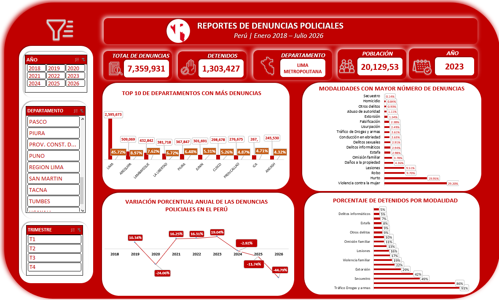

# Análisis de Denuncias Policiales en el Perú | Excel

## Descripción del proyecto

Este proyecto tiene como objetivo realizar un análisis de las denuncias policiales registradas en el Perú durante el periodo de enero de 2018 a julio de 2026, utilizando herramientas de Microsoft Excel para la extracción, limpieza, transformación, modelado y visualización de datos.

La base de datos fue obtenida del portal oficial del Estado peruano [Gob.pe](https://www.gob.pe/), con la finalidad de organizar la información y desarrollar un análisis que permita explorar el comportamiento de las denuncias policiales a través del tiempo, su distribución geográfica y las diferentes modalidades registradas.

## Proceso de desarrollo

### 1. Obtención y extracción de datos
- Búsqueda y descarga de la base de datos de denuncias policiales desde el portal oficial Gob.pe.
- Revisión inicial de la estructura y contenido del conjunto de datos.
- Preparación de la información para su posterior procesamiento.

### 2. Limpieza y transformación de datos – Power Query
- Identificación y tratamiento de valores nulos e inconsistencias.
- Estandarización de nombres y formatos de las columnas.
- Transformación de tipos de datos.
- Preparación y organización de las tablas para el modelado de datos.
  

  

### 3. Modelado de datos – Esquema dimensional
- Creación de tablas de dimensiones y una tabla de hechos.
- Organización de la información mediante tablas relacionadas.
- Preparación de una estructura basada en un modelo dimensional para facilitar las consultas y el análisis.
  
  

  

### 4. Relaciones entre tablas – Power Pivot
- Creación de relaciones entre la tabla de hechos y las tablas de dimensiones.
- Implementación del modelo de datos para mantener la integridad de las relaciones.
- Configuración de las conexiones necesarias para el análisis mediante tablas dinámicas.
  
  

  

### 5. Cálculos y métricas – DAX
- Creación de medidas y cálculos utilizando DAX.
- Elaboración de indicadores para analizar la cantidad y distribución de las denuncias.
- Cálculo de porcentajes y variaciones para facilitar la interpretación de los resultados.

### 6. Visualización de datos – Dashboard
- Creación de tablas dinámicas y gráficos dinámicos.
- Incorporación de segmentadores para facilitar la exploración de la información.
- Diseño de un dashboard interactivo para visualizar los principales indicadores y tendencias de las denuncias policiales.
  
   

  

## Herramientas utilizadas

- **Microsoft Excel:** procesamiento y análisis de datos.
- **Power Query:** limpieza y transformación de datos.
- **Power Pivot:** modelado y relaciones entre tablas.
- **DAX:** creación de medidas e indicadores.
- **Tablas dinámicas y gráficos dinámicos:** análisis y visualización de información.

## Resultado del proyecto

Se desarrolló un dashboard interactivo que permite explorar las denuncias policiales registradas en el Perú entre enero de 2018 y julio de 2026, facilitando la consulta de indicadores, tendencias temporales, distribución geográfica y modalidades de denuncia.

## Fuente de datos

Portal oficial del Estado peruano: [Gob.pe](https://www.gob.pe/)

**Periodo analizado:** Enero de 2018 – Julio de 2026.
