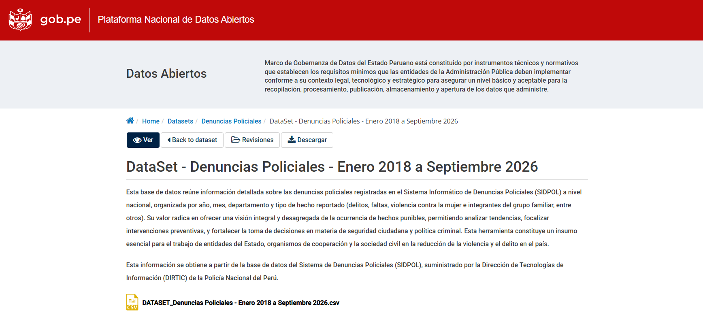
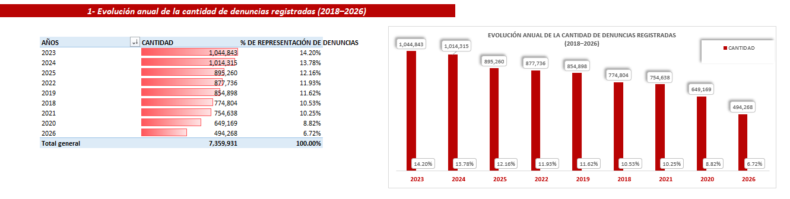
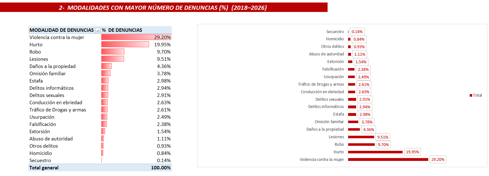
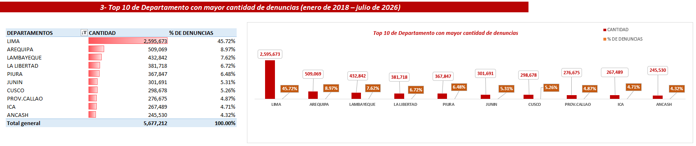
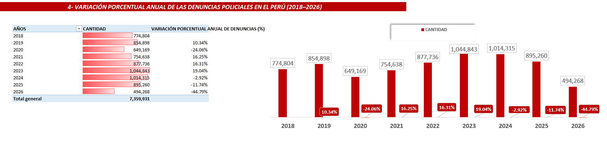
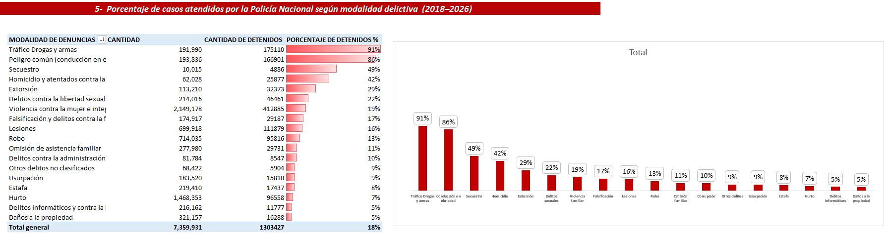

# Análisis de Denuncias Policiales en el Perú | Excel

## Descripción del proyecto

Este proyecto tiene como objetivo realizar un análisis de las denuncias policiales registradas en el Perú durante el periodo de enero de 2018 a julio de 2026, utilizando herramientas de Microsoft Excel para la extracción, limpieza, transformación, modelado y visualización de datos.

La base de datos fue obtenida del portal oficial del Estado peruano https://www.datosabiertos.gob.pe/dataset/denuncias-policiales/resource/64c01d53-4402-4e5a-936a-4bce5b3d1008 , con la finalidad de organizar la información y desarrollar un análisis que permita explorar el comportamiento de las denuncias policiales a través del tiempo, su distribución geográfica y las diferentes modalidades registradas.

## Proceso de desarrollo

### 1. Obtención y extracción de datos
- Búsqueda y descarga de la base de datos de denuncias policiales desde el portal oficial Gob.pe.
- Revisión inicial de la estructura y contenido del conjunto de datos.
- Preparación de la información para su posterior procesamiento.

  

### 2. Limpieza y transformación de datos – Power Query
- Identificación y tratamiento de valores nulos e inconsistencias.
- Estandarización de nombres y formatos de las columnas.
- Transformación de tipos de datos.
- Preparación y organización de las tablas para el modelado de datos.
  

  

### 3. Modelado de datos – Esquema dimensional
- Creación de tablas de dimensiones y una tabla de hechos.
- Organización de la información mediante tablas relacionadas.
- Preparación de una estructura basada en un modelo dimensional para facilitar las consultas y el análisis.
  
  

  

### 4. Relaciones entre tablas – Power Pivot
- Creación de relaciones entre la tabla de hechos y las tablas de dimensiones.
- Implementación del modelo de datos para mantener la integridad de las relaciones.
- Configuración de las conexiones necesarias para el análisis mediante tablas dinámicas.
  
 

  

### 5. Cálculos y métricas – DAX
- Creación de medidas y cálculos utilizando DAX.
- Elaboración de indicadores para analizar la cantidad y distribución de las denuncias.
- Cálculo de porcentajes y variaciones para facilitar la interpretación de los resultados.

### 6. Visualización de datos – Dashboard
- Creación de tablas dinámicas y gráficos dinámicos.
- Incorporación de segmentadores para facilitar la exploración de la información.
- Diseño de un dashboard interactivo para visualizar los principales indicadores y tendencias de las denuncias policiales.
  
   

  

## Herramientas utilizadas

- **Microsoft Excel:** procesamiento y análisis de datos.
- **Power Query:** limpieza y transformación de datos.
- **Power Pivot:** modelado y relaciones entre tablas.
- **DAX:** creación de medidas e indicadores.
- **Tablas dinámicas y gráficos dinámicos:** análisis y visualización de información.

## Resultado del proyecto

Se desarrolló un dashboard interactivo que permite explorar las denuncias policiales registradas en el Perú entre enero de 2018 y julio de 2026, facilitando la consulta de indicadores, tendencias temporales, distribución geográfica y modalidades de denuncia.

- Durante el período de enero de 2018 y julio de 2026, se registraron un total de 7,359,931 denuncias policiales en el Perú. El año 2023 presentó la mayor cantidad de denuncias registrando con el 14.20 %, que equivale  a 1,044,843 registros.

  

- Durante el período comprendido entre enero de 2018 y julio de 2026, la modalidad de violencia contra la mujer e integrantes del grupo familiar representó el 29,20 % del total de denuncias registradas, posicionándose como la modalidad con mayor participación porcentual.

  

- Durante el período comprendido entre enero de 2018 y julio de 2026, Lima Metropolitana registró la mayor cantidad de denuncias policiales, con un total de 2.595.673 que representa 45.72% , posicionándose como la ubicación con mayor número de denuncias dentro del conjunto de datos analizado.

  

- Este indicador muestra la variación porcentual anual de las denuncias policiales respecto al año anterior, permitiendo identificar los períodos de mayor incremento y disminución. El mayor incremento se registró en 2019, con un 10,34 %, mientras que la mayor reducción se observó en 2020, con un 24,06 %. 

  

- El tráfico ilícito de drogas y la tenencia de armas presentan el mayor porcentaje de casos atendidos por la Policía Nacional con un 91,2 %, mientras que los daños a la propiedad registran el menor procentaje con un 5,1 %.

  

## Fuente de datos

Portal oficial del Estado peruano:https://www.datosabiertos.gob.pe/?query=Denuncias%20Policiales%20&sort_by=changed&sort_order=DESC

**Periodo analizado:** Enero de 2018 – Julio de 2026.
